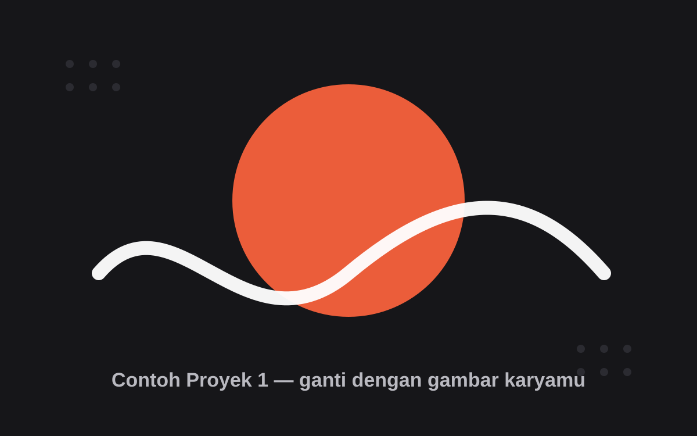

# Website Portfolio

Website portfolio pribadi dengan desain **gelap monokrom + aksen abu-abu terang** (gaya template "Bentos"),
lengkap dengan **mode tampilan Terang / Gelap / Ikut Sistem** dan
**tombol ganti bahasa Indonesia / English**.
Dibuat pakai HTML, CSS, dan JavaScript murni — tanpa build tool, tanpa `npm install`.

## Cara membuka

Klik dua kali `index.html`, atau buka lewat Live Server di editor.

> Catatan: kalau bisa, jalankan lewat server lokal (misalnya ekstensi *Live Server* di VS Code)
> supaya semua fitur berjalan paling optimal. Buka langsung sebagai file juga tetap bisa.

## Struktur

```
portfolio/
├── index.html              <- semua konten ada di sini
├── .nojekyll               <- supaya GitHub Pages tidak memproses lewat Jekyll
├── .gitignore
├── css/
│   ├── variables.css       <- warna & token tema (light + dark)
│   └── style.css           <- layout & komponen
├── js/
│   ├── theme.js            <- logika ganti tema + tombol settings
│   ├── i18n.js             <- tombol bahasa ID/EN + semua terjemahan
│   └── main.js             <- navbar, filter proyek, animasi scroll, lightbox
└── assets/
    ├── img/
    │   ├── profile.jpg     <- foto profil (kartu kiri bagian TENTANG)
    │   ├── work-1..3.svg   <- gambar contoh proyek (placeholder)
    │   └── avatar.svg      <- avatar placeholder cadangan
    └── certs/              <- gambar/PDF sertifikat
```

## Cara ganti tema

Klik **ikon gear** di header kanan (tetap terlihat saat halaman di-scroll).
Pilih salah satu:

| Pilihan | Efek |
| --- | --- |
| Terang | Selalu mode terang |
| Gelap | Selalu mode gelap |
| Ikut Sistem | Mengikuti pengaturan tema di OS pengunjung |

Pilihan **tersimpan otomatis** di `localStorage` browser. Saat pengunjung membuka lagi
website ini, tema terakhir langsung dipakai — tanpa kedipan warna.

### Mengubah tema default pengunjung baru

Buka `index.html`, cari blok konfigurasi di `<head>`:

```js
window.__PORTFOLIO_THEME__ = {
  storageKey: 'portfolio-theme',
  defaultPref: 'dark'   // ganti ke 'system' (ikut OS) atau 'light'
};
```

`'dark'` = tema gelap khas desain ini (pengaturan sekarang). Nilai ini dipakai
oleh script anti-flash dan `js/theme.js`, jadi cukup diubah di satu tempat.

## Cara ganti bahasa (ID / EN)

Klik tombol **ID / EN** di header (kanan atas). Seluruh teks halaman langsung
berganti bahasa, dan `<html lang>` ikut disesuaikan untuk pembaca layar.
Pilihan **tersimpan otomatis** di `localStorage` (key `portfolio-lang`).

Bahasa Indonesia adalah bahasa sumber — teks di `index.html` tetap Bahasa
Indonesia, lalu `js/i18n.js` yang menerjemahkannya ke Inggris.

| Yang mau diubah | Letak di `js/i18n.js` |
| --- | --- |
| Teks biasa | object `TEXT` (kunci = teks Indonesia persis seperti di HTML) |
| Nilai atribut (`alt`, `aria-label`, `title`, `data-title`, `data-meta`, `content`) | object `ATTR` |
| Judul yang berisi tag HTML | beri `data-i18n-html="kunci"` di `index.html`, lalu isi `HTML_MAP` |
| Bahasa default pengunjung baru | `DEFAULT_LANG` (`'id'` atau `'en'`) |
| Key penyimpanan | `STORAGE_KEY` |

Tips: kalau menambah teks baru di `index.html`, tambahkan pasangan
Indonesia → Inggris di `TEXT` supaya ikut diterjemahkan. Teks yang tidak ada
di dictionary akan dibiarkan apa adanya (aman).

## Cara mengisi data diri

| Yang mau diubah | Letak |
| --- | --- |
| Nama, role, foto, sosial | `index.html` → bagian `TENTANG` (kartu kiri) |
| Foto profil | ganti `assets/img/profile.jpg` (rasio 1:1, tampil bulat) |
| Teks perkenalan & badge | `index.html` → bagian `TENTANG` (kartu kanan) |
| Marquee tech | `index.html` → kartu "Tech yang sedang saya pelajari" |
| Biodata | `index.html` → bagian `BIODATA` |
| Proyek + filter | `index.html` → bagian `PROYEK` |
| Pendidikan & pengalaman | `index.html` → bagian `PENDIDIKAN & PENGALAMAN` |
| Sertifikat | `index.html` → bagian `SERTIFIKAT` |
| Kontak & sosmed | `index.html` → bagian `KONTAK` (termasuk link `mailto:` dan `wa.me`) |

Semua bagian punya komentar penanda di HTML, jadi mudah dicari.

Nilai yang masih bertanda **"Contoh:"** atau **"20XX"** adalah placeholder —
ganti semuanya dengan data aslimu sebelum dipublikasikan.

## Cara menambah sertifikat

1. Taruh file sertifikat di `assets/certs/` (nama bebas, misal `aws-2024.pdf`).
2. Di `index.html`, **copy satu blok** berikut dan ubah isinya:

```html
<article class="cert reveal">
  <button type="button" class="cert__open"
          data-lightbox="assets/certs/NAMA-FILE.png"
          data-title="Judul Sertifikat"
          data-meta="Penerbit &middot; 2024">
    <span class="cert__thumb">
      
    </span>
    <span class="cert__body">
      <span class="cert__title">Judul Sertifikat</span>
      <span class="cert__issuer">Penerbit</span>
    </span>
  </button>
  <div class="cert__foot">
    <span>2024</span>
    <a class="cert__link" href="LINK-KREDENSIAL" target="_blank" rel="noopener">Lihat kredensial ↗</a>
  </div>
</article>
```

Tips: untuk thumbnail, pakai gambar (PNG/JPG/WebP). Lightbox saat ini hanya
untuk gambar. Untuk file PDF, isi `href` dengan alamat PDF-nya (terbuka di tab
baru) dan **jangan** isi `data-lightbox` dengan PDF.

## Cara menambah proyek

1. Buka `index.html`, cari bagian **PROYEK**.
2. **Copy satu blok** berikut dan ubah isinya:

```html
<article class="project-item reveal" data-category="latihan">
  <div class="project-image">
    
    <a class="details-btn" href="LINK-DEMO-ATAU-REPO" aria-label="Buka proyek">
      <svg viewBox="0 0 24 24" fill="currentColor" aria-hidden="true"><path d="M16.0037 9.41421L7.39712 18.0208L5.98291 16.6066L14.5895 8H7.00373V6H18.0037V17H16.0037V9.41421Z"></path></svg>
    </a>
  </div>
  <div class="project-content">
    <span class="project-cat">Latihan</span>
    <h3 class="project-title">Judul Proyek</h3>
    <p class="project-desc">
      Satu-dua kalimat: masalah yang diselesaikan, stack yang dipakai, dan hasilnya.
    </p>
  </div>
</article>
```

Tips:
- `data-category` dan label `.project-cat` harus cocok dengan tombol filter
  (`latihan`, `web`, atau `kuliah`). Mau kategori baru? Tambah tombolnya di
  `<ul class="project-filter">` memakai pola yang sama.
- Gambar proyek: taruh di `assets/img/`, rasio ideal 16:10 (mis. 1200×750).
- 3-6 kartu sudah cukup.

## Mengubah warna tema

Semua warna ada di `css/variables.css`, terpisah per tema:

```css
:root { --accent: #d4d4d8; --bg: #000000; --surface: #121214; ... }  /* tema gelap  */
[data-theme="light"] { --accent: #45454d; ... }                      /* tema terang */
```

Ganti nilai `--accent` (aksen abu-abu terang), `--accent-strong` (warna hover),
`--bg` (latar halaman), dan `--surface` (kartu) untuk mengubah nuansa warna
seluruh halaman sekaligus. Tombol settings tidak perlu diubah.

## Checklist konten sebelum publish

Cari dan ganti semua placeholder yang masih ada. Kata kunci pencarian:
`Contoh:`, `(ganti)`, `20XX`, `nama@email.com`, `+62 812-3456-7890`,
`linkedin.com/in/username`.

- [ ] Nama lengkap — samakan ejaan, lalu lengkapi di brand & biodata
- [ ] Foto profil — `assets/img/profile.jpg` sudah terisi; ganti kalau mau
- [ ] Judul halaman, meta description, dan OG title (sudah terisi nama — periksa)
- [ ] Biodata: tempat & tanggal lahir, alamat, dan tahun angkatan (`20XX`)
- [ ] Badge "Terbuka untuk magang & kolaborasi" — sesuaikan statusmu
- [ ] Marquee tech: sesuaikan daftar tech yang benar-benar kamu pelajari
- [ ] Tombol "Unduh CV" — masih `href="#"`; taruh file CV-mu lalu isi linknya
- [ ] Proyek: ganti 3 kartu contoh (gambar + teks) dengan proyek asli
- [ ] Pendidikan & pengalaman: isi tahun, ganti/isi item "Contoh:"
- [ ] Sertifikat: ganti gambar contoh, judul, penerbit, tahun, URL kredensial
- [ ] Email & WhatsApp (link `mailto:` dan `wa.me` ikut diganti)
- [ ] LinkedIn — GitHub sudah terisi, cek `index.html` bagian `KONTAK`

## Deploy ke GitHub Pages

1. Pastikan `gh` dan `git` terpasang, lalu login sekali:
   ```bash
   gh auth login
   ```
2. Dari folder ini:
   ```bash
   git add .
   git commit -m "Initial portfolio"
   gh repo create NAMA-REPO --public --source=. --remote=origin --push
   ```
3. Buka repo di GitHub → **Settings → Pages** → **Deploy from a branch**
   → branch `main`, folder `/ (root)`.
4. Situs tersedia di `https://USERNAME.github.io/NAMA-REPO/`.
   Kalau repo bernama `USERNAME.github.io`, alamatnya ada di root.
5. Untuk custom domain: tambahkan file `CNAME`, atur DNS, lalu aktifkan HTTPS.

Saat menambahkan canonical, `og:url`, JSON-LD, dan `sitemap.xml`, gunakan URL
lengkap halaman GitHub Pages di atas (termasuk nama repo).

## Dukungan browser & aksesibilitas

- Target: dua versi terakhir Chrome, Edge, Firefox, dan Safari.
- Kontras teks kecil sudah disesuaikan ke WCAG AA.
- Navigasi keyboard: Tab, Esc, dan tombol panah di panel tema.
- `prefers-reduced-motion` dihormati.
- Tanpa JavaScript: konten tetap tampil, menu mobile tetap bisa dipakai,
  tema mengikuti OS, dan tombol settings + bahasa + filter proyek disembunyikan.

## Catatan teknis

- Tema mengikuti: `localStorage` → `window.__PORTFOLIO_THEME__.defaultPref`
  (default `dark` = tema gelap desain ini; bisa diubah ke `system`/`light`).
- Ada script anti-flash di `<head>` supaya tidak kedip terang sebelum jadi gelap.
- Kalau JavaScript mati, `css/variables.css` otomatis mengikuti tema OS.
- Sudah mendukung navigasi keyboard (Tab / Esc / panah) dan `prefers-reduced-motion`.
- Font (Poppins) diambil dari Google Fonts. Kalau ingin 100% offline, hapus 3 baris
  `<link ...fonts.googleapis.com...>` di `<head>` — font sistem otomatis dipakai.
